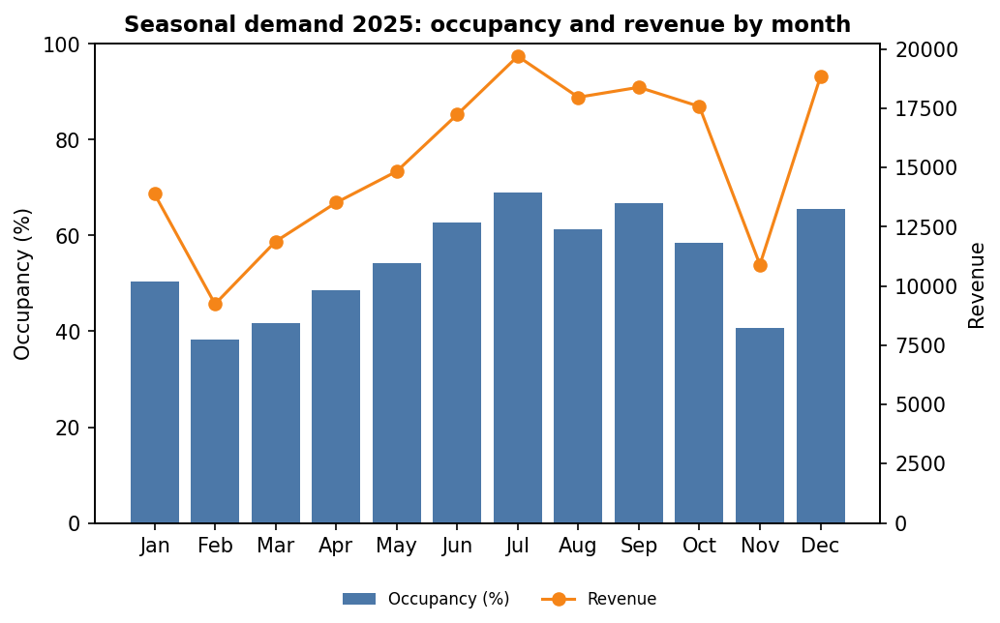

# Hotel Booking Analyzer

A desktop application (Python + Tkinter) for a small hotel. It stores room and
booking records, lets staff search and update bookings, and analyses occupancy,
booking sources, room usage and seasonal demand with charts.



## Problem and objective
A small hotel records bookings but cannot easily see occupancy patterns, which
channels bring guests, how rooms are used, or how demand changes through the
year. **Objective:** maintain booking records and provide booking analysis.

## Features (mapped to the requirements)
| Requirement | Where |
|---|---|
| Maintain room and booking records | Rooms and Bookings tabs; `hotel/manager.py` |
| Search / filter | Filter bar on the Bookings tab (guest, room type, status, source, date range) |
| Update booking status | "Update status" panel; rules in `models.TRANSITIONS` |
| Occupancy measures with defined assumptions | Reports tab; `hotel/analysis.py` |
| Compare periods / room types | Compare tab (table + chart) |
| At least two visual reports | Four Matplotlib charts in `hotel/reports.py` |
| Persistent storage | CSV files in `data/` (`hotel/storage.py`) |
| 3+ user-defined modules | `models`, `storage`, `manager`, `analysis`, `reports`, `gui` |
| NumPy / pandas | `analysis.py` (vectorised night counting, grouping, summaries) |
| Validation and exception handling | `ValidationError`, `StorageError`, GUI error dialogs |
| Testing | `tests/` (30 unit tests) |

## Project structure
```
hotel-booking-analyzer/
├── main.py              # entry point
├── hotel/
│   ├── models.py        # Room, Booking, constants, validation
│   ├── storage.py       # CSV load/save, demo-data generator
│   ├── manager.py       # add/search/update logic, double-booking check
│   ├── analysis.py      # NumPy/pandas measures
│   ├── reports.py       # Matplotlib figures
│   └── gui.py           # Tkinter interface
├── tests/               # unittest test suite
├── data/                # rooms.csv, bookings.csv (demo data included)
└── docs/                # images used in this README
```

## Setup and run
Requires Python 3.9+ (Tkinter ships with the Windows/macOS installers; on
Ubuntu/Debian run `sudo apt install python3-tk`).

```bash
python -m venv .venv
.venv\Scripts\activate          # Windows   (macOS/Linux: source .venv/bin/activate)
pip install -r requirements.txt
python main.py                  # opens the app with the demo data in data/
```
Options: `--data-dir PATH` to use another folder; `--sample-data` to regenerate
the demo data (overwrites files in that folder).

## Analysis assumptions
1. A stay occupies the nights from check-in up to, but not including, check-out.
2. Confirmed, Checked-in and Checked-out bookings occupy a room; Cancelled do not.
3. Available room-nights = rooms x days in the period (both end dates included).
4. Revenue = occupied nights x the room's nightly rate (no taxes or extras; a rate change applies to all past bookings).
5. Occupancy % = occupied / available room-nights x 100.
6. ADR = revenue / occupied room-nights; RevPAR = revenue / available room-nights.
7. Booking count, average stay and cancellation rate assign a booking to the period containing its check-in date.

When comparing periods of different lengths, use the percentage measures
(occupancy, ADR, RevPAR) rather than raw totals.

## Business rules
* A room cannot have two active bookings on the same night (same-day turnover is allowed).
* Status flow: Confirmed → Checked-in → Checked-out; Confirmed → Cancelled. Other changes are rejected.
* Dates use `YYYY-MM-DD`; check-out must be after check-in; rates must be positive.

## Tests
```bash
python -m unittest discover -v
```

## Possible extensions
Guest records, per-booking rates, CSV/PDF export of reports, a forecasting chart.
